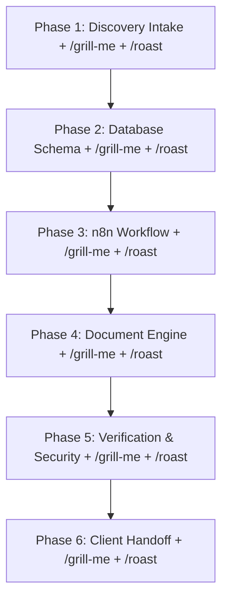

# Master Workflow 1: Zero-Subscription Client Operations & Automation OS (MW01)

## Executive Overview

**MW01** is ZORIXEL's primary agency client deliverable for non-tech founders ($1,500–$5,000 Sprints). It builds enterprise-grade business automation infrastructure with **zero recurring software subscriptions** using self-hosted n8n (`npx n8n` / Docker), Google Workspace Sheets, Google Apps Script, Notion, and automated Python document generation engines.

> [!IMPORTANT]
> **Mandatory Core Context Read**: Every execution of MW01 MUST pre-fetch and apply instructions from [MEMORY.md](file:///d:/AI-OS/MEMORY.md), [decisions/log.md](file:///d:/AI-OS/decisions/log.md), [AGENTS.md](file:///d:/AI-OS/AGENTS.md), [GEMINI.md](file:///d:/AI-OS/GEMINI.md), and [WORKSPACE_MAP.md](file:///d:/AI-OS/WORKSPACE_MAP.md) before executing tasks.

> [!NOTE]
> **Mandatory Dual-Gate Pipeline (`/grill-me` + `/roast`)**: Every phase of MW01 MUST execute [.agents/skills/grill-me/SKILL.md](file:///d:/AI-OS/.agents/skills/grill-me/SKILL.md) asking **at least 5 to 10 questions**, and [.agents/skills/roast/SKILL.md](file:///d:/AI-OS/.agents/skills/roast/SKILL.md) (7-persona council) to refine ideas and code edits.

---

## Combined Skills Matrix

- **Context Pre-Fetch Engine**: `MEMORY.md` + `decisions/log.md` + `AGENTS.md` + `GEMINI.md` + `WORKSPACE_MAP.md`
- **Socratic Discovery Engine**: `.agents/skills/grill-me/SKILL.md` (Mandatory 5–10 Socratic questions per phase)
- **Adversarial Audit Engine**: `.agents/skills/roast/SKILL.md` (7-persona council audit per phase)
- **Proactive Auto-Evolver**: `.agents/skills/skill-workflow-evolver/SKILL.md` (Proactively suggests new tool integrations in chat)
- **Intake & Discovery**: `.agents/skills/to-questionnaire/SKILL.md`
- **Visual Node Automation Engine**: `.agents/skills/n8n/SKILL.md` (Node reference at `references/n8n-nodes-guide.md`)
- **Spreadsheet & Workspace Engine**: `.agents/skills/gws-automation-engine/SKILL.md`
- **Bi-Directional Data Sync**: `.agents/skills/notion-sync/SKILL.md`
- **Formula & Schema Engine**: `.agents/skills/notion-formula-builder/SKILL.md`
- **PDF Document Engine**: `.agents/skills/pdf/SKILL.md` (Text/Table extraction, invoice creation, `pypdf` page merging)
- **Excel Financial Model Engine**: `.agents/skills/xlsx/SKILL.md` (`openpyxl`, `pandas`, `_xlfn.` formula guards)
- **Word Documentation Engine**: `.agents/skills/docx/SKILL.md` (`docx-js` DXA table widths, XML editing)
- **Client Handoff Package**: `.agents/skills/interactive-operator-guide-generator/SKILL.md`

---

## 6-Phase Execution Pipeline (with Integrated `/grill-me` + `/roast` Gates)

---

### Phase 1: Intake & Discovery (`grill-me` + `roast` + `to-questionnaire`)
- **Mandatory `/grill-me` Gate 1**: Ask **at least 5 to 10 questions** on client business goals, entity models, user roles, notification channels, data privacy, and operational bottlenecks.
- **Mandatory `/roast` Gate 1**: Convene 7-persona roast council to stress-test intake assumptions.
- Run `/to-questionnaire` on raw client text or transcripts.

### Phase 2: Database & Schema Provisioning (`grill-me` + `roast` + `gws-automation-engine` + `notion-formula-builder`)
- **Mandatory `/grill-me` Gate 2**: Ask **at least 5 to 10 questions** on column types, status dropdown values, formula null-handling, cross-sheet references, and primary keys.
- **Mandatory `/roast` Gate 2**: Red-team database schema for performance, null crashes, and security vulnerabilities.
- Provision Google Sheets via `gws` (`shell=False`) with `getHeaderMap(sheet)` helper or Notion database with defensive Formula 2.0.

### Phase 3: Self-Hosted n8n Workflow Construction (`grill-me` + `roast` + `n8n`)
- **Mandatory `/grill-me` Gate 3**: Ask **at least 5 to 10 questions** on webhook endpoints, payload structures, auth headers, retry policies, cron frequencies, and connection logic.
- **Mandatory `/roast` Gate 3**: Stress-test n8n workflow graph for execution errors, node timeouts, and API credential leakage.
- Construct executable production workflow JSON (`output/n8n_full_workflow.json`) and 1-click client launch scripts (`start_n8n.bat` / `start_n8n.sh`).

### Phase 4: Status-Driven Document Generation (`grill-me` + `roast` + `pdf` + `xlsx` + `docx`)
- **Mandatory `/grill-me` Gate 4**: Ask **at least 5 to 10 questions** on PDF invoice styling, ReportLab XML tags, Excel formatting (`openpyxl`), Word DXA widths, and page merge rules.
- **Mandatory `/roast` Gate 4**: Verify zero rendering glitches, font bounding box errors, or broken cell formulas.
- Generate PDFs (`reportlab` + `pypdf`), Excel models (`openpyxl`), and Word SOPs (`docx-js`) auto-triggered on row status changes.

### Phase 5: Automated Verification & Security Gate (`grill-me` + `roast` + `security-os` + `loop-engine`)
- **Mandatory `/grill-me` Gate 5**: Ask **at least 5 to 10 questions** on IDOR risk thresholds, CORS origins, API key isolation, test scripts, and static security audit criteria.
- **Mandatory `/roast` Gate 5**: Run 7-persona security and performance audit sweep.
- Verify 100% clean exit on `aios_gws_health_check.py`, `test_notion_formula.py`, and `security_os_runner.py audit .`.

### Phase 6: Interactive Client Handoff Package (`grill-me` + `roast` + `interactive-operator-guide-generator`)
- **Mandatory `/grill-me` Gate 6**: Ask **at least 5 to 10 questions** on client branding, setup steps, test diagnostic endpoints, launch script paths, and PDF SOP layout.
- **Mandatory `/roast` Gate 6**: Stress-test handoff dashboard for usability, copyable script accuracy, and diagnostic button connectivity.
- Generate **Interactive HTML Setup Dashboard** (`client_setup_dashboard.html`) and **Compiled PDF SOP** (`client_setup_guide.pdf`).

---

## 🔄 Proactive Tool & Skill Upgrade Protocol

Whenever a new skill, tool, script, MCP server, or workflow is added or upgraded in AIOS:
1. `skill_workflow_evolver_runner.py` automatically detects and maps the new capability.
2. AI agents will **proactively prompt Atinek Maurya in chat**:
   > *"I noticed we just added/upgraded [Tool/Skill Name]. It can enhance Master Workflow 1 by [Specific Benefit]. Would you like me to integrate it into MW01?"*
