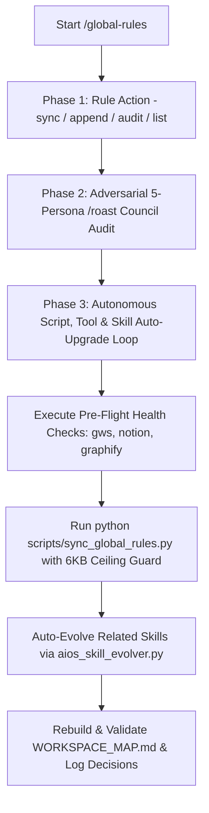

# ZORIXEL AIOS Global Rules & Error Prevention Engine (`/global-rules`)

## Overview & Tri-Mode Execution

The `/global-rules` engine manages, appends, audits, and validates the workspace-wide procedural error prevention rules (Rules 1.1 to 1.58+) housed in [GLOBAL_ERROR_PREVENTION_RULES.md](file:///d:/AI-OS/references/GLOBAL_ERROR_PREVENTION_RULES.md).

It ensures that `AGENTS.md` and `GEMINI.md` maintain lean, high-signal Invariant Cores (<4KB) with **Zero Prompt Truncation**, while dynamically validating and propagating procedural rules to all active skills via [aios_skill_evolver.py](file:///d:/AI-OS/scripts/aios_skill_evolver.py).

Invokable via:
- **Slash Command**: `/global-rules [action]` or `/sync-global-rules`
- **Dynamic Intent**: Triggered automatically when discovering new terminal errors, writing system rules, or completing session post-mortems.
- **Inter-Skill Calling**: Invoked programmatically by `/session-postmortem-audit`, `/improve-system`, `/os-audit`, `/new-client`, or `/gstack`.

---

## 3-Phase Execution Architecture



---

## 📑 PHASE 1: RULE ACTION & MANIFESTATION

### Mode 1: Synchronize (`/global-rules sync`)
- Executes `python scripts/sync_global_rules.py` via `run_command`.
- Validates the Markdown table integrity of `references/GLOBAL_ERROR_PREVENTION_RULES.md`.
- Asserts that both `AGENTS.md` and `GEMINI.md` remain strictly under the 6KB ceiling with **Zero Prompt Truncation**.
- Confirms zero drift across system prompts.

### Mode 2: Append New Rule (`/global-rules append "[Category]" "[Rule Text]"`)
- Reads `references/GLOBAL_ERROR_PREVENTION_RULES.md`.
- Auto-increments the next Rule ID (e.g. `Rule 1.59`).
- Formats and appends the new rule to Section 1 (Error Prevention Rules) or Section 2 (First-Try Delivery Policies).
- Proceeds immediately to Phase 2 for adversarial red-teaming.

### Mode 3: Audit Alignment (`/global-rules audit`)
- Scans `references/GLOBAL_ERROR_PREVENTION_RULES.md`, `AGENTS.md`, and `GEMINI.md`.
- Verifies that rule numbers are monotonically increasing with no duplicate IDs or broken table formatting.
- Verifies that prompt invariant cores correctly reference `references/GLOBAL_ERROR_PREVENTION_RULES.md` as the SSOT.

### Mode 4: List Rules (`/global-rules list`)
- Displays all registered Error Prevention Rules and Delivery Policies in clean, structured markdown table format.

---

## PHASE 2: ADVERSARIAL `/roast` COUNCIL AUDIT GATE

Before finalizing any rule addition, convene the 5-Persona ZORIXEL AIOS Roast Council (`/roast`):

1. **The Contrarian (Red Team)**: Finds hidden edge cases, terminal shell mangling risks, token leak hazards, or un-tested load-bearing assumptions in the new rule.
2. **The Logician (First Principles)**: Audits logical integrity, ensures formula null guards and regex sanitizations are 100% deterministic.
3. **The Expansionist (Bull)**: Evaluates if the rule can be codified into an automated pre-flight Python script in `scripts/`.
4. **The Researcher (Evidence)**: Verifies CLI parameters, API routes, and vendor documentation.
5. **The Buyer / Operator (Atinek Maurya)**: Confirms the rule eliminates future manual user corrections and saves session execution time.

---

## PHASE 3: AUTONOMOUS SCRIPT, TOOL & SKILL AUTO-UPGRADE LOOP

After completing Phase 1 and Phase 2, execute the autonomous auto-upgrade loop:

1. **Validate Global Rules**: Run `python scripts/sync_global_rules.py` to assert syntax validity and size constraints.
2. **Run Pre-Flight Health Sweep**:
   - `python scripts/aios_gws_health_check.py` (Verify Node.js, `gws run.js`, OAuth tokens, GCP Drive/Sheets APIs).
   - `python scripts/test_notion_formula.py` (Verify Notion formula syntax and parens balance).
   - `python scripts/graphify_runner.py status` (Verify knowledge graph hubs and UTF-8 encoding).
   - `python scripts/aios_master_runner.py health` (Master pre-flight gate).
3. **Auto-Upgrade Related Master Skills**:
   - If the new rule establishes a domain-specific safeguard (e.g. Next.js App Router boundary, Playwright context resolution, or WebGL memory disposal), execute `python scripts/aios_skill_evolver.py record --skill <skill_name> --lesson "<lesson>"` to mutate the target skill safely.
4. **Register & Log**:
   - Rebuild and validate `WORKSPACE_MAP.md` via `python scripts/rebuild_workspace_map.py` and `python scripts/validate_workspace_map.py`.
   - Log the system upgrade in `decisions/log.md`.

---

## 🐍 Python Execution Boilerplate for Appending Rules & Auto-Upgrading

```python
import os
import subprocess

WORKSPACE_ROOT = r"d:\AI-OS"
REF_RULES_PATH = os.path.join(WORKSPACE_ROOT, "references", "GLOBAL_ERROR_PREVENTION_RULES.md")
SYNC_SCRIPT = os.path.join(WORKSPACE_ROOT, "scripts", "sync_global_rules.py")
EVOLVER_SCRIPT = os.path.join(WORKSPACE_ROOT, "scripts", "aios_skill_evolver.py")
MAP_REBUILD_SCRIPT = os.path.join(WORKSPACE_ROOT, "scripts", "rebuild_workspace_map.py")
MAP_VALIDATE_SCRIPT = os.path.join(WORKSPACE_ROOT, "scripts", "validate_workspace_map.py")

def append_sync_and_upgrade(category, rule_title, rule_detail, target_skill=None):
    # 1. Read & Append to SSOT
    with open(REF_RULES_PATH, "r", encoding="utf-8") as f:
        content = f.read()
        
    rule_count = content.count("| **Rule 1.") + 1
    new_rule_line = f"| **Rule 1.{rule_count}** | **{category}** | High | **{rule_title}**: {rule_detail} |\n"
    
    table_end = content.find("\n---\n\n##  SECTION 2")
    if table_end != -1:
        updated_content = content[:table_end] + new_rule_line + content[table_end:]
    else:
        updated_content = content + "\n" + new_rule_line
        
    with open(REF_RULES_PATH, "w", encoding="utf-8") as f:
        f.write(updated_content)
        
    # 2. Validate SSOT and verify prompt sizes <6KB
    subprocess.run(["python", SYNC_SCRIPT], check=True)
    
    # 3. Auto-evolve target master skill if provided
    if target_skill:
        subprocess.run(["python", EVOLVER_SCRIPT, "record", "--skill", target_skill, "--lesson", f"{rule_title}: {rule_detail}"], check=True)
        
    # 4. Rebuild and validate workspace map
    subprocess.run(["python", MAP_REBUILD_SCRIPT], check=True)
    subprocess.run(["python", MAP_VALIDATE_SCRIPT], check=True)
    
    print(f"[SUCCESS] Appended Rule 1.{rule_count}, verified prompt sizes, and auto-evolved system!")
```

---

## ⚡ Learned Edge Cases & Execution Recipes
- Always enforce the 6KB ceiling check in sync_global_rules.py to permanently prevent prompt truncation in AGENTS.md and GEMINI.md.
- Always use aios_skill_evolver.py to propagate new error rules to specific Tier 1 master skills rather than manual uncontrolled edits.
- Always run rebuild_workspace_map.py before validate_workspace_map.py to prevent pre-commit alignment warnings.
- Maintain references/GLOBAL_ERROR_PREVENTION_RULES.md as SSOT and keep prompt invariant cores <6KB.
