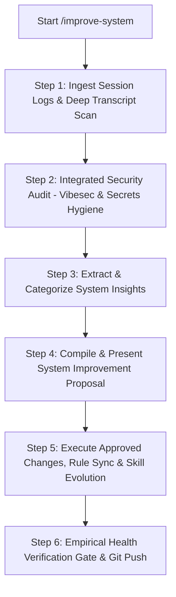

# System Self-Improvement, Security Audit & Deployment Workflow (`/improve-system`)

## Overview & Tri-Mode Execution

The `/improve-system` skill is the master consolidation and deployment loop for ZORIXEL AIOS. It transforms session friction, debugging breakthroughs, and new architectural patterns into permanent system intelligence across Obsidian [brain-aios](file:///d:/AI-OS/brain-aios/wiki/experiences/postmortems/), [GLOBAL_ERROR_PREVENTION_RULES.md](file:///d:/AI-OS/references/GLOBAL_ERROR_PREVENTION_RULES.md), [aios_skill_evolver.py](file:///d:/AI-OS/scripts/aios_skill_evolver.py), and [MEMORY.md](file:///d:/AI-OS/MEMORY.md).

Invokable via:
- **Slash Command**: `/improve-system [optional_focus]` or `/ship-learnings`
- **Dynamic Intent**: Triggered automatically when finishing a major coding milestone, refining a custom skill, or running an end-of-session system enhancement.
- **Inter-Skill Calling**: Invoked programmatically by `/session-postmortem-audit`, `/session-handoff`, `/gsd-complete-milestone`, or `/gstack`.

---

## 6-Step Execution Workflow



---

### Step 1: Ingest Session Logs & Deep Transcript Analysis
1. Inspect the active session transcript logs (`<appDataDir>\brain\<conversation-id>\.system_generated\logs\transcript.jsonl`).
2. Scan the trajectory backward to identify:
   - User corrections, explicit layout/design directives, and formatting feedback.
   - Script, compiler, or build tool failures (HTTP 429 rate limits, JSX syntax crashes, scoping errors).
   - Tool execution workarounds (Playwright dependency paths, Windows shell escaping, subprocess JSON passing).

### Step 2: Integrated Security Audit (Vibesec & Secrets Hygiene)
Run a security check across all modified workspace files:
1. **Secrets Hygiene**:
   - Check for hardcoded API keys, OAuth tokens, or passwords in source files, scripts, or committed templates.
   - Verify that credentials use environment variables or encrypted credential stores.
2. **Web & Code Security Audit (Vibesec Guidelines)**:
   - Verify IDOR protection, tenant isolation, JWT `httpOnly` cookie enforcement, Zod input validation, and SSRF private IP blocking.
   - Ensure safe shell command execution (`shell=False` for JSON payloads).

### Step 3: Extract & Categorize System Insights
Categorize findings into four distinct system outputs:
1. **Post-Mortem & Story**: High-leverage narrative document for `brain-aios/wiki/experiences/postmortems/`.
2. **Global Error Rules**: New procedural error prevention rules for `references/GLOBAL_ERROR_PREVENTION_RULES.md`.
3. **Skill Evolution Recipes**: Specific learned recipes to inject into target master skills via `scripts/aios_skill_evolver.py`.
4. **Persistent Memory Updates**: High-signal operator baseline and architectural updates for `MEMORY.md` (4 structured sections).

### Step 4: Compile & Present System Improvement Proposal
Present a clear, structured proposal to Atinek Maurya detailing:
- **Learnings & Security Findings**: Narrative story summary and security posture.
- **Rule Additions**: Specific rules to append to `GLOBAL_ERROR_PREVENTION_RULES.md`.
- **Skill Evolution Diffs**: Skills to be evolved via `aios_skill_evolver.py`.
- **Memory & Map Updates**: Proposed updates to `MEMORY.md` and `WORKSPACE_MAP.md`.

Wait for operator confirmation ("YES") before executing file writes.

### Step 5: Execute Approved Changes & System Evolution
Upon approval:
1. **Write Experience Document**:
   - Create `brain-aios/wiki/experiences/postmortems/YYYY-MM-DD-[slug].md`.
   - Register the file in `brain-aios/wiki/experiences/postmortems/INDEX.md`.
2. **Synchronize Global Rules**:
   - Append new rules to `references/GLOBAL_ERROR_PREVENTION_RULES.md`.
   - Run `python scripts/sync_global_rules.py` (verifying `AGENTS.md` and `GEMINI.md` remain <6KB).
3. **Auto-Evolve Target Skills**:
   - Run `python scripts/aios_skill_evolver.py record --skill <skill_name> --lesson "<lesson_text>"`.
4. **Update Persistent Memory**:
   - Update `MEMORY.md` preserving its 4 clean structured sections (<5KB).
5. **Rebuild & Validate Workspace Map**:
   - Run `python scripts/rebuild_workspace_map.py`.
   - Run `python scripts/validate_workspace_map.py`.
6. **Log Decisions**:
   - Record architectural updates in `decisions/log.md`.

### Step 6: Empirical Health Verification Gate & Git Push
1. **Execute Unified Pre-Flight Health Gate**:
   ```powershell
   python scripts/aios_master_runner.py health
   ```
   Confirm **100% PASS** on all subsystems.
2. **Git Commit & Push**:
   ```powershell
   git add .
   git commit -m "feat(system): improve AIOS skills, update persistent memory, and synchronize vault logs"
   git push origin main
   ```
3. **Confirm Clean Repository Status**: Run `git status`.

---

## ⚡ Learned Edge Cases & Execution Recipes
- Always verify that sync_global_rules.py passes with zero prompt truncation before staging git commits.
- Always use aios_skill_evolver.py for targeted skill mutations to preserve YAML schemas and enforce 5-slot LRU pruning.
- Always run rebuild_workspace_map.py before validate_workspace_map.py.
- Always update brain-aios/wiki/experiences/postmortems/INDEX.md when saving a new experience document.
- Run universal_workspace_integrity_sweep.py when renaming or restructuring directory trees.
