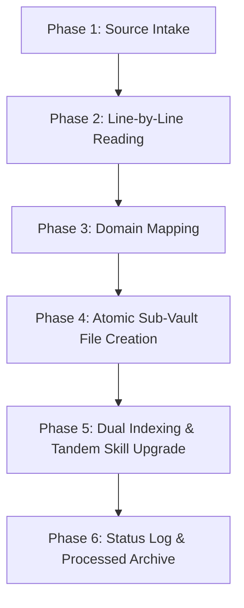

# ZORIXEL AIOS Awwwards Case Study & Research Ingestion Engine (`/ingest-awwwards-case-study`)

## Overview & Invocation

This skill provides a 100% deterministic, non-lossy ingestion pipeline for processing Awwwards, Codrops, Medium, and agency winner case studies into ZORIXEL's [references/awwwards-research-vault](file:///d:/AI-OS/references/awwwards-research-vault).

Invokable via:
- **Slash Command**: `/ingest-awwwards-case-study [file_path_or_url]`
- **Natural Intent**: Triggered automatically whenever a user provides a new case study URL or raw markdown file to learn from.

---

## 6-Phase Non-Lossy Ingestion Protocol



### Phase 1: Source Intake & Defuddle Parsing
1. **If Input is a Web URL**: Run `npx defuddle parse <source> --markdown --frontmatter` or fetch via `read_url_content` / `agent-reach`, saving the raw markdown to `scratch/awwwards_ingestion_raw/{slug}.md`.
2. **If Input is a Local Markdown File**: Ensure it resides in `scratch/awwwards_ingestion_raw/{slug}.md`.

### Phase 2: Line-by-Line Reading (Zero-Loss Mandate)
Execute `view_file` on `scratch/awwwards_ingestion_raw/{slug}.md` from line 1 through the end.
- **NEVER** summarize code blocks into placeholders like `// ... Rest of code`.
- Copy exact GSAP timelines, Three.js shaders, GPGPU compute shaders, math formulas, and typography CSS rules in full.

### Phase 3: Domain Categorization & Sub-Vault Mapping
Categorize extracted learnings into the 7 core sub-vault directories:
- `01-design-principles-and-aesthetics`: Art direction, visual themes, color dopamine math, 3% SVG noise.
- `02-typography-spacing-grid-math`: Extended font rules (`wdth` 125), font pairings, 12-column bento grids.
- `03-gsap-lenis-motion-scrollytelling`: Lenis smooth scroll, GSAP timelines, SplitText blur reveals, `Flip.fit()` transitions, virtual scroll.
- `04-webgl-threejs-fragment-shaders`: Three.js `onBeforeCompile()`, GPGPU particles, GLSL fragment shaders, CRT filters, volumetric fog.
- `05-case-studies-and-tutorials`: Step-by-step case study narratives and component lists.
- `06-judging-criteria-and-master-checklist`: Judging rules, scoring rubrics, 57 anti-slop gates.
- `07-ux-psychology-and-brand-choreography`: Digital Hospitality, anticipatory menu expansion, preloader handovers, continuous scroll flow.

> **Dynamic Sub-Vault Creation Rule**: If an ingested case study introduces a novel domain that does not fit sub-vaults `01` through `07` (e.g., audio spatial choreography or WebGL asset streaming), automatically spawn sub-vault `08-{domain-name}/` and its top-level `INDEX.md`.

### Phase 4: Atomic Sub-Vault File Creation
Create a new Markdown file inside the target sub-vault folder named `{site-slug}-{technique-slug}.md`:
```markdown
---
title: {Site Name} — {Technique Name}
domain: research
summary: {Detailed summary of technical breakthroughs}
critical_directives:
- {Actionable directive 1}
- {Actionable directive 2}
read_triggers:
- When building Awwwards-grade websites {keyword}
tags:
- {tag1}
- {tag2}
updated: 'YYYY-MM-DD'
---

# {Site Name} — {Technique Name}

## 1. Concept & Art Direction
...

## 2. Unsummarized Code Implementation
```typescript
// Complete unsummarized code block
```
```

### Phase 5: Dual Indexing & Tandem Skill Reference Upgrade
1. Update the target sub-vault's `INDEX.md` to list the new atomic file with its `read_triggers`.
2. Update the master research vault index at [references/awwwards-research-vault/INDEX.md](file:///d:/AI-OS/references/awwwards-research-vault/INDEX.md).
3. Synchronize the corresponding reference file inside [.agents/skills/website-design-engine/references/](file:///d:/AI-OS/.agents/skills/website-design-engine/references/) in tandem.

### Phase 6: Status Tracking & Archiving
1. Update [scratch/awwwards_ingestion_raw/INGESTION_STATUS.md](file:///d:/AI-OS/scratch/awwwards_ingestion_raw/INGESTION_STATUS.md) marking the raw file as `100% Verified`.
2. Move the raw source file to `scratch/awwwards_ingestion_raw/processed_archives/`.
3. Append milestone completion to active context in [hot.md](file:///d:/AI-OS/hot.md).

---

## Verification & Anti-Loss Checklist

Before marking an ingestion task complete, verify:
- [ ] 100% of code blocks from raw source exist verbatim in the atomic sub-vault file.
- [ ] Frontmatter `read_triggers` contain explicit multi-word keywords.
- [ ] Sub-vault `INDEX.md` and main `references/awwwards-research-vault/INDEX.md` are updated.
- [ ] `website-design-engine/references/` has been updated in tandem.
- [ ] `INGESTION_STATUS.md` and `hot.md` reflect the new state.
