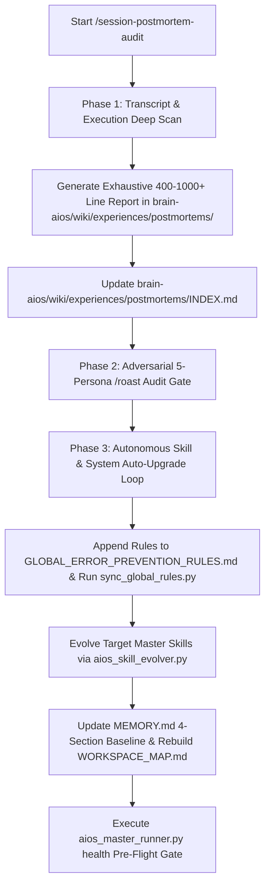

# ZORIXEL AIOS Session Post-Mortem & System Evolution Engine (`/session-postmortem-audit`)

## Overview & Tri-Mode Execution

The `/session-postmortem-audit` skill is the canonical post-flight engine for ZORIXEL AIOS. It deep-scans the active conversation transcript (`transcript.jsonl`), converts friction points and tool exceptions into permanent error prevention rules in [GLOBAL_ERROR_PREVENTION_RULES.md](file:///d:/AI-OS/references/GLOBAL_ERROR_PREVENTION_RULES.md), creates un-summarized 400–1000+ line post-mortem retrospectives in Obsidian [brain-aios](file:///d:/AI-OS/brain-aios/wiki/experiences/postmortems/), and auto-evolves Tier 1 Master Skills via [aios_skill_evolver.py](file:///d:/AI-OS/scripts/aios_skill_evolver.py).

Invokable via:
- **Slash Command**: `/session-postmortem-audit` or `/session-report` or `/postmortem`
- **Dynamic Intent**: Triggered automatically when completing complex coding sprints, client deliverables, system refactors, or multi-tool debugging sessions.
- **Inter-Skill Calling**: Invoked programmatically by `/improve-system`, `/session-handoff`, `/gsd-complete-milestone`, `/verify-design`, or `/gstack`.

---

## 3-Phase Execution Architecture

---

## 📏 MANDATORY DEPTH & LENGTH CONSTRAINT (400 TO 1000+ LINES)

> **CRITICAL REQUIREMENT:** The generated report MUST NOT be brief, summarized, or condensed into superficial bullet points. Every execution MUST produce an exhaustive, un-summarized, production-grade Markdown document between **400 and 1000+ lines** in length.

---

## 📑 PHASE 1: TRANSCRIPT ANALYSIS & REPORT GENERATION

Inspect the active session transcript logs (`<appDataDir>\brain\<conversation-id>\.system_generated\logs\transcript.jsonl`), executed tool calls, terminal outputs, and file diffs. Create a new markdown report inside `brain-aios/wiki/experiences/postmortems/YYYY-MM-DD-[slug].md` containing three un-summarized, exhaustive sections:

### Section 1: Comprehensive Terminal, Syntax, API & Environment Error Catalog
For EVERY error (syntax glitch, subprocess path error, shell quote mangling, expired OAuth token, HTTP 403 API block, or formula exception):
- **Error Categorization Matrix**: Classify by Shell & Execution, Path & Binary, CLI Wrapper, OAuth Auth, Argument Passing, GCP Platform, Encoding, Formula Engine, or API Protocol.
- **Exact Error Log**: Paste the raw terminal error snippet or traceback.
- **Empirical Root Cause**: Explain why the OS, shell, tool parameter, or API rejected the call.
- **Effective Solution**: Detail the exact code/command fix that permanently resolved the issue.
- **Mandatory Pre-Execution Rule**: Formulate a strict rule (e.g., `Rule 1.X`) to be added to `references/GLOBAL_ERROR_PREVENTION_RULES.md` to prevent re-occurrence.

### Section 2: User Instruction-to-Delivery & Tweak Iteration Audit
Trace every prompt given by Atinek Maurya:
- **User Instruction**: Quote or accurately state the user's intent.
- **Desired Output**: Define the target deliverable.
- **Iteration Count**: Log how many tweaks/attempts were needed before achieving 100% satisfaction.
- **AIOS First-Try Rule**: Formulate the exact execution policy so AIOS delivers the output on the FIRST attempt in future sessions without requiring user corrections.

### Section 3: Repeatable Patterns & Reusable Skill Specifications
Identify every repeatable workflow pattern discovered during the session:
- Write complete, production-grade `SKILL.md` templates (YAML frontmatter + step-by-step instructions + code patterns) ready to be saved into `.agents/skills/`.

---

## PHASE 2: ADVERSARIAL `/roast` COUNCIL AUDIT & BLUEPRINT EXPANSION

Convene the ZORIXEL AIOS 5-Persona Roast Council (`/roast`) to stress-test the Phase 1 report and transcript:

### The 5-Persona Council Review
1. **The Contrarian (Red Team)**: Identifies missing edge cases, unmentioned terminal bugs, shell mangling risks, or un-tested load-bearing assumptions.
2. **The Expansionist (Bull)**: Uncovers 10x automation opportunities, missing leverage points, and automated pre-flight health script ideas.
3. **The Logician (First Principles)**: Audits logical integrity, ensures formula null guards are 100% deterministic, and categorizes error patterns cleanly.
4. **The Researcher (Evidence)**: Verifies vendor documentation, CLI syntax standards, and platform API updates.
5. **The Buyer / Operator (Atinek Maurya)**: Evaluates whether the report eliminates future manual work, reduces session time, and enables 1-click AIOS upgrades.

### Section 4 Expansion: ZORIXEL AIOS Permanent Upgrade Blueprint & Pre-Flight Scripts
Expand the report to include Section 4:
- **Verdict & Scores**: Log the Council verdict (GO / RESHAPE / KILL) and scores out of 10.
- **Production Pre-Flight Python Scripts**: Provide full, runnable Python source code for automated health checks (e.g. `scripts/aios_gws_health_check.py`, `scripts/test_notion_formula.py`) that test environment readiness BEFORE running complex workflows.
- **System Prompt Rules**: Provide exact rule snippets to be appended to `references/GLOBAL_ERROR_PREVENTION_RULES.md`.

---

## PHASE 3: AUTONOMOUS SKILL & AIOS AUTO-UPGRADE LOOP

After completing Phase 1 and Phase 2, execute the self-evolution loop to make AIOS smarter with every run:

1. **Auto-Generate Pre-Flight Scripts**: Automatically write/update all runnable Python pre-flight health scripts specified in Section 4 directly into `scripts/` using `write_to_file`.
2. **Execute Health Checks**: Run `python scripts/<preflight_script>.py` via `run_command` to verify that the health scripts execute cleanly with 100% success.
3. **Synchronize Global Rules**: Append newly discovered error prevention rules to `references/GLOBAL_ERROR_PREVENTION_RULES.md` and run `python scripts/sync_global_rules.py`. Confirm `AGENTS.md` and `GEMINI.md` remain <6KB with ZERO prompt truncation.
4. **Auto-Evolve Target Master Skills**: Execute `python scripts/aios_skill_evolver.py record --skill <skill_name> --lesson "<lesson_text>"` to inject learned recipes and edge cases directly into the target skills with 5-slot LRU pruning.
5. **Register in Brain Vault & Map**:
   - Register the new post-mortem file in [brain-aios/wiki/experiences/postmortems/INDEX.md](file:///d:/AI-OS/brain-aios/wiki/experiences/postmortems/INDEX.md).
   - Rebuild and validate [WORKSPACE_MAP.md](file:///d:/AI-OS/WORKSPACE_MAP.md) via `python scripts/rebuild_workspace_map.py` and `python scripts/validate_workspace_map.py`.
   - Record milestone architectural decisions in [decisions/log.md](file:///d:/AI-OS/decisions/log.md).
6. **Update Persistent Memory**: Update [MEMORY.md](file:///d:/AI-OS/MEMORY.md) ensuring all 4 structured sections remain clean, high-signal, and under 5KB.
7. **Unified Health Gate Verification**: Run `python scripts/aios_master_runner.py health` to ensure 100% PASS across all subsystems.

---

## ⚡ Learned Edge Cases & Execution Recipes
- Always verify shell=False on Windows child subprocesses passing JSON payloads to prevent quote stripping.
- Always check that sync_global_rules.py keeps AGENTS.md and GEMINI.md < 6KB to permanently prevent prompt truncation.
- Always use aios_skill_evolver.py for skill mutation to guarantee schema validity and 5-slot LRU pruning.
- Always update brain-aios/wiki/experiences/postmortems/INDEX.md when saving a new session retrospective.
- Register all new postmortems in brain-aios/wiki/experiences/postmortems/INDEX.md immediately after generation.
