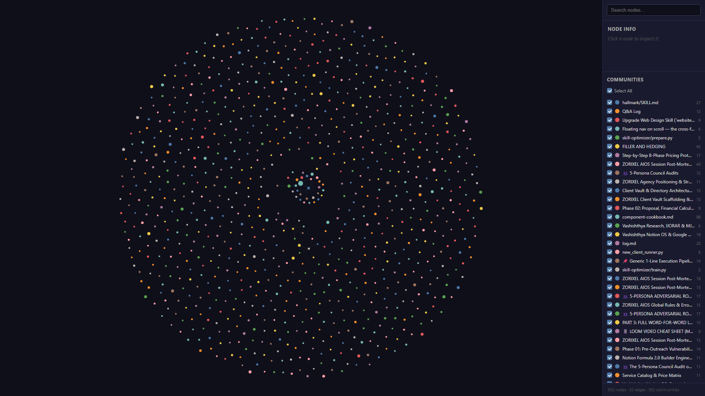
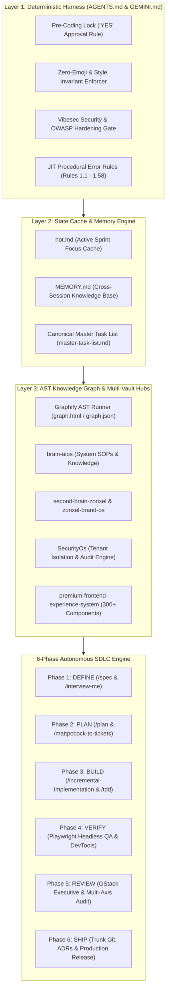

<div align="center">

# ZORIXEL AI-OS
### Production-Grade Autonomous Engineering & Business Operating System

<p>
  
  
  
  
  
</p>

<p>
  <a href="#executive-summary"><b>Executive Summary</b></a> |
  <a href="#visual-architecture--graph-proof"><b>Visual Proof</b></a> |
  <a href="#core-architectural-pillars"><b>Architectural Pillars</b></a> |
  <a href="#competitive-matrix"><b>Comparative Matrix</b></a> |
  <a href="#enterprise--agency-leverage"><b>Business Leverage</b></a> |
  <a href="#quickstart--runtime-benchmarks"><b>Quickstart</b></a>
</p>

</div>

---

## Executive Summary

**ZORIXEL AI-OS** is a deterministic, multi-agent engineering operating system designed to replace probabilistic chat guessing with rigorous, verified software delivery. Built from first principles by **Atinek Maurya**, it integrates an **Abstract Syntax Tree (AST) Knowledge Graph**, a **6-Phase Software Development Life Cycle (SDLC) engine**, and **Zero-SaaS client infrastructure**.

Unlike standard agent frameworks that suffer from context drift, infinite execution loops, and uncontrolled code modifications, ZORIXEL AI-OS enforces a strict **3-Layer Separation of Concerns**:

1. **Deterministic Harness Layer**: Immutable invariants, pre-coding locks ("YES" rule), and procedural error prevention rules (Rules 1.1 to 1.58).
2. **State & Memory Layer**: Cross-session memory persistence (`MEMORY.md`) and active sprint caching (`hot.md`) with sub-second initialization.
3. **AST Knowledge Graph Layer**: 500+ node semantic dependency mapping via **Graphify**, eliminating brute-force file scanning and token waste.

---

## Visual Architecture & Graph Proof

### Interactive AST Knowledge Graph in Action

ZORIXEL AI-OS maps the entire codebase, vaults, and skill libraries into a unified dependency graph. Before executing any complex task, agents query Graphify to trace call paths, detect tightly coupled modules, and inspect community clusters.

<div align="center">
  
  <p><i>Live demonstration of Graphify AST navigation, dynamic search querying, and architectural hub inspection.</i></p>
</div>

<details>
<summary><b>Click to view high-resolution static architecture graph</b></summary>
<br>

<div align="center">
  
</div>
</details>

---

## The 3-Layer System Architecture



---

## Core Architectural Pillars

### 1. Deterministic Safety Harness & Invariant Core
- **Pre-Coding Lock ("YES" Rule)**: The system enforces absolute zero-write permissions during planning and discovery. No file edits or code emissions can occur until the operator explicitly reviews the plan and types "YES".
- **Procedural Error Prevention Matrix**: Enforces 58 runtime invariants (Rules 1.1 to 1.58), covering variable scoping safety, Playwright dependency path resolution, SVG geometry preservation, and headless font rendering.
- **OWASP & Vibesec Hardening**: Mandatory checks for Insecure Direct Object References (IDOR), Server-Side Request Forgery (SSRF) private IP blocks, `httpOnly` JWT cookies, and Zod mass-assignment validation.

### 2. Graphify AST Knowledge Graph & Context Engineering
- **Semantic Code Navigation**: Instead of stuffing tens of thousands of tokens into prompts, the AI-OS parses workspace files into AST nodes (`root`, `brain`, `zorixel`, `frontend`).
- **Community Clustering & Centrality**: Calculates node degree centrality to identify god-nodes and structural dependencies before refactoring.
- **Sub-Second Session Bootup**: `python scripts/aios_bootup_context.py` aggregates hot sprint focus, persistent memory, and task state in under 500ms.

### 3. 6-Phase Autonomous SDLC Engine
- **Define**: Converts raw intent into structured specifications via `/mattpocock-to-spec` and `/spec-driven-development`.
- **Plan**: Deconstructs specs into atomic, testable execution tickets with strict Definition of Done (DoD).
- **Build**: Implements thin vertical slices using Test-Driven Development (TDD: red-green-refactor loop) and official documentation groundings.
- **Verify**: Headless browser automation via Playwright running 5-viewport visual audits, console error monitoring, and runtime regression tests.
- **Review**: Dynamic GStack executive review team (Garry Tan model):
  - **CEO Lens**: User value and scope discipline.
  - **EM Lens**: Surgical diffs and zero speculative abstractions.
  - **Designer Lens**: Typography, micro-interactions, and Hallmark anti-slop rules.
  - **QA Lens**: Empirical test pass logs.
- **Ship**: Automated ADR documentation, changelog generation, and production deployment gates.

### 4. Enterprise Commercial Automation & Zero-SaaS Moat
- **Zero Recurring SaaS Fees**: Replaces expensive Zapier/Make.com monthly subscriptions ($500-$2,000/mo) with native Google Apps Script triggers, self-hosted n8n workflows, and Notion Master Databases.
- **High-Velocity Delivery Corridors**: Scaffolds production-grade business automation hubs and custom Next.js dashboards delivered in rapid $1,500 to $5,000 client sprints.
- **Automated Client Vault Engine**: Standardized 8-phase client onboarding and delivery pipeline (`clients/`) ensuring tenant isolation and client asset protection.

---

## Comparative Matrix

| Capability | Naive LLM Wrappers | Standard Frameworks (CrewAI / AutoGen) | LangGraph | ZORIXEL AI-OS |
|---|---|---|---|---|
| **Execution Model** | Probabilistic Prompting | Role-Playing Swarms | State Graph Code | **Deterministic State Machine + AST** |
| **Code Modification Safety** | Unrestricted / Hallucinatory | Prompt-Instructed | Graph Node Edits | **Strict Pre-Coding Lock ("YES" Rule)** |
| **Context Retrieval** | Brute-force file reading | Vector RAG Embeddings | Vector Embeddings | **Graphify AST Dependency Graph** |
| **Automated QA & Visual Test** | None (Manual Inspection) | Code interpreter only | External tool calls | **Playwright Headless 5-Viewport QA** |
| **Error Prevention Standard** | Ad-hoc error handling | Retry loops | State retry | **58 Just-In-Time Procedural Rules** |
| **Security Hardening** | Unvalidated | Basic environment vars | Basic environment vars | **Vibesec OWASP Hardened Gate** |
| **Cross-Session Memory** | Lost after context reset | Vector DB storage | Postgres checkpointer | **3-Layer Memory (`hot.md` + `MEMORY.md`)** |
| **Commercial Client Stacks** | None | Generic scripts | Custom APIs | **Zero-Fee Automation (n8n + GAS)** |

---

## Enterprise & Agency Leverage

### How It Powers Atinek Maurya (ZORIXEL Agency Founder)
- **10x Engineering Velocity**: Enables a single operator to design, build, test, and ship complete fullstack systems and automation infrastructures within 48 to 72 hours.
- **Zero Knowledge Decay**: Cross-session memory and active sprint caching eliminate the need to re-explain project context or architecture across turns.
- **Empirical Quality Assurance**: Every delivery is backed by automated visual regression screenshots and unit test reports, eliminating human oversight fatigue.

### How It Helps Any Company or Enterprise Team
- **Elimination of Context Degradation**: Replaces bloated 100k-token prompts with targeted AST queries, reducing token costs by over 70% and preventing hallucinations.
- **Institutional Memory Preservation**: Prevents tribal knowledge loss by documenting architectural decisions (ADRs) and session learnings automatically to markdown vaults.
- **Deterministic CI/CD Safety**: Ensures AI agents cannot deploy unverified code or alter production databases without automated multi-axis review passes.
- **Slashing Operational SaaS Overhead**: Bridges enterprise data pipelines with zero-license infrastructure, saving thousands of dollars in monthly automation fees.

---

## Quickstart & Runtime Benchmarks

### 1. Requirements
- Python 3.10+
- Node.js 18+
- Chromium / Playwright headless runtime

### 2. Booting Context (Under 500ms)
Verify system health, persistent memory, and active sprint focus:

```bash
python scripts/aios_bootup_context.py
```

*Sample Terminal Output:*
```text
=== ZORIXEL AIOS CHAT BOOTUP CONTEXT SNAPSHOT ===
Master Index: d:\AI-OS\context\00_MASTER_INDEX.md
--- ACTIVE SESSION FOCUS (hot.md) ---
  Active Project: Production-Grade Dual-Track Architecture & Showcase
  Model Target: Gemini 3.8 Flash High / Claude 3.5 Sonnet
--- PERSISTENT MEMORY HIGHLIGHTS (MEMORY.md) ---
  Operator: Atinek Maurya (Founder of ZORIXEL)
  Core Value: Deterministic Engineering, Zero-Fee Client Automations
--- CANONICAL TASK STATUS ---
  Master Task List: Operational (100% Integrity)
==================================================
```

### 3. Multi-Vault Semantic Search
Query across all connected knowledge vaults, research libraries, and project codes:

```bash
python scripts/aios_deep_search.py "autonomous SDLC"
```

### 4. AST Knowledge Graph Runner
Update or query the codebase dependency graph:

```bash
# Query specific architectural nodes
python scripts/graphify_runner.py query "skills" --hub root

# Regenerate the interactive HTML visualization
python scripts/graphify_runner.py build
```

---

## Workspace Directory Topology

```text
d:\AI-OS\
├── .agents\
│   └── skills\                # 80+ Tier 1 Modular Skills (Tri-Mode Execution)
├── brain-aios\                # Primary Knowledge Vault & System SOPs
│   └── wiki\
│       ├── checklists\        # Canonical Task Master Lists
│       └── research\          # Reference Manuals & Architecture Guides
├── second-brain-zorixel\      # Content Strategy, Market Research & Lore
├── zorixel-brand-os\          # Brand Tokens, Typography & Visual Identity
├── SecurityOs\                # Tenant Isolation, Threat Models & Audit Rules
├── premium-frontend\          # 300+ Component Catalog across 11 Frameworks
├── graphify-out\              # Compiled AST Knowledge Graph (graph.html)
├── docs\
│   └── assets\                # Visual Proof Captures & Walkthrough Media
├── context\                   # Master Indices & Architecture Manifests
├── decisions\                 # System Architecture Decision Records (ADRs)
├── scripts\                   # Deterministic Automation Engines & CLI Runners
├── clients\                   # Isolated Client Delivery Vaults
├── hot.md                     # Active Session Focus Cache
├── MEMORY.md                  # Persistent Cross-Session Memory Layer
└── README.md                  # Canonical Repository Documentation
```

---

## Security, Compliance, & Invariant Policies

- **Strict Zero-Emoji Mandate**: Clean, high-signal, enterprise-grade prose across all documentation, code comments, and git histories.
- **Tenant Isolation**: Absolute data boundaries between client repositories in `clients/` and system internals.
- **SSRF & Private Network Defense**: Hardened socket configurations blocking requests to loopback, link-local, and internal cloud metadata IP addresses.
- **Zero-Secret Commit Guarantee**: Environment variables and API keys are verified through local keyring managers (`gh`, `gws`) with automated pre-commit secret scans.

---

## Author & Contact

**Atinek Maurya**  
*Founder, ZORIXEL — AI Workflows & Business Automation Agency*  
- **Focus**: Production-Grade AI Engineering, Autonomous Agent Architectures, Zero-Fee Client Automations
- **Repository**: [AIS-OS on GitHub](https://github.com/atinek-182/AIS-OS)
